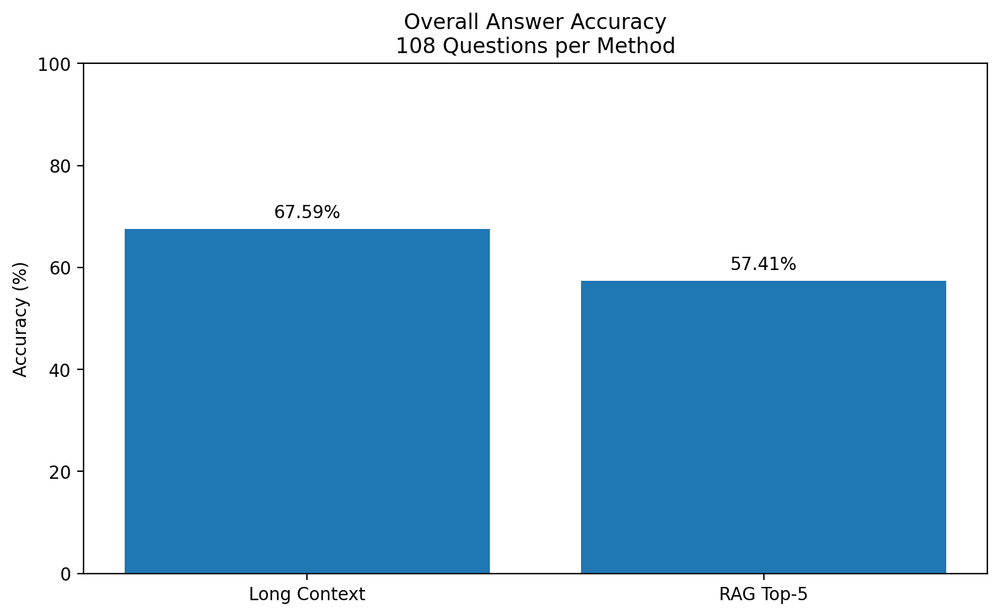

# RAG vs. Long-Context Prompting

When answering a question about a long document, is it better to give a language model **the entire context**, or **only the most relevant passages**?

This research project compares those two approaches using the same questions and generation model:

- **Long Context:** Gemini receives the full source text, question, and answer choices.
- **Retrieval-Augmented Generation (RAG):** The document is split into chunks. An embedding model retrieves the five most relevant chunks, which are then sent to Gemini.

The goal is to understand the trade-off between **answer accuracy, input size, and processing time**, not to assume that one method is always better.

## How the experiment works

The questions come from [LongBench v2](https://huggingface.co/datasets/zai-org/LongBench-v2). A balanced set of 120 questions was selected and frozen before evaluating answers: 20 questions in each combination of Single-Document or Multi-Document QA and short, medium, or long context.

- **Pilot:** 12 questions used to check the workflow.
- **Main experiment:** 108 separate questions, each answered by both methods (216 evaluations).
- **Generation model:** Gemini 3.8 Flash.
- **RAG setup:** Gemini Embedding 2, 1,000-token chunks, 100-token overlap, cosine similarity, top 5 passages.
- **Evaluation:** Multiple-choice accuracy, paired statistical comparison, generation input tokens, and recorded timings.

The pilot results were kept separate from the main analysis.

## Main results

| Metric | Long Context | RAG Top-5 |
| --- | ---: | ---: |
| Correct answers | 73 / 108 | 62 / 108 |
| Accuracy | **67.59%** | **57.41%** |
| Average generation input tokens | 180,955 | 5,665 |
| Average generation time | 5.71 s | 2.12 s |

Long Context had **10.19 percentage points higher observed accuracy**. The exact paired McNemar test returned **p = 0.0522**, so this difference did **not** meet the 0.05 significance threshold.

RAG used **96.87% fewer input tokens during answer generation**, but this does **not** include its embedding and indexing work. The recorded RAG indexing time also includes API pacing and caching effects, so generation speed alone is not a full end-to-end efficiency comparison.

Four Long Context requests on long documents ended without a valid answer after reaching the configured output-token limit. They remain counted as unsuccessful attempts in the primary analysis.

### A follow-up robustness check

An additional analysis looked only at the **104 questions where both methods returned valid answers**:

| Metric | Long Context | RAG Top-5 |
| --- | ---: | ---: |
| Accuracy | 70.19% | 57.69% |

The paired test for this subset gave **p = 0.0146**. However, excluding the four failed Long Context responses can introduce selection bias. **The original 108-question analysis remains the primary result**; this is a sensitivity check, not a replacement.

## Where to find everything

| Location | What's inside |
| --- | --- |
| [Notebooks 01–04](notebooks/) | Dataset exploration, model selection, token counts, and sampling |
| [Notebook 05](notebooks/05_paired_pilot.ipynb) | Pilot experiment |
| [Notebook 06](notebooks/06_main_experiment.ipynb) | Main experiment and data checks |
| [Notebook 07](notebooks/07_results_analysis.ipynb) | Accuracy, statistics, efficiency, error review, and charts |
| [Notebook 08](notebooks/08_progress_report_3_demo.ipynb) | Read-only interactive results demonstration |
| [Notebook 09](notebooks/09_robustness_check.ipynb) | Invalid-response sensitivity analysis |
| [Results](results/) | Saved pilot and main experiment CSV files |
| [Samples](samples/) | Frozen question lists |
| [Figures](figures/) | Accuracy, context-length, token, and sensitivity charts |

**Start here:** Open [the main results CSV](results/main/paired_main_108_v1.csv) to inspect the recorded answers, or [Notebook 07](notebooks/07_results_analysis.ipynb) for the full analysis. Notebook 08 provides a compact presentation of those saved results.

The notebooks were developed in Google Colab. Some read files from the project's Google Drive checkpoint folders; they are not all standalone one-click reproductions. Rerunning model inference requires a Gemini API key and may incur API charges. The saved results and figures can be inspected without rerunning the experiment.

## Current status

The main experiment, results analysis, and follow-up sensitivity check are complete. Final research write-up and presentation work are the remaining stages.

These findings apply to **one generation model, one fixed RAG configuration, and a limited question sample**. They show a useful accuracy-versus-efficiency trade-off, not a universal winner.
